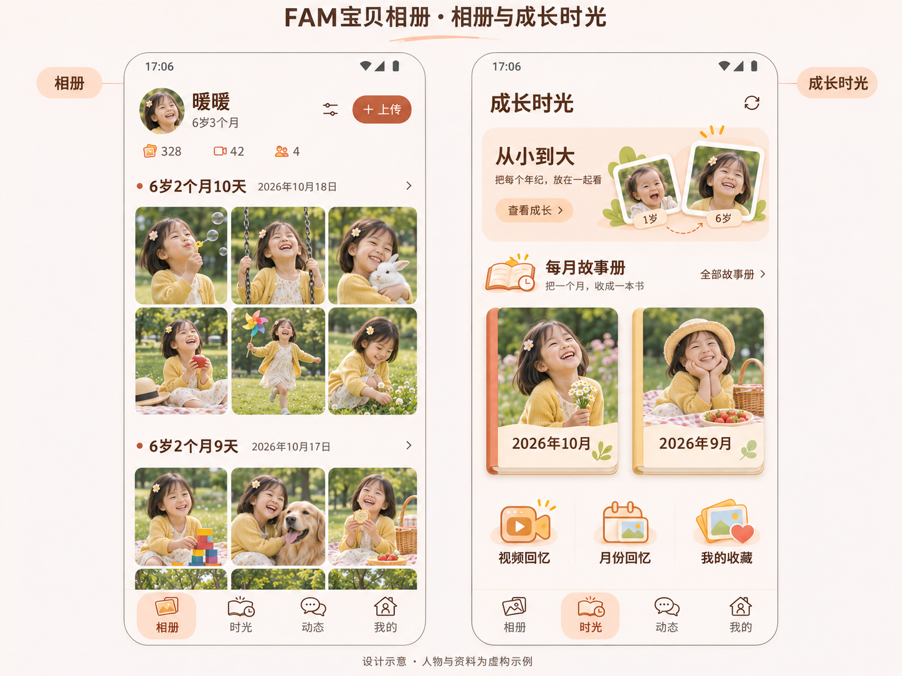
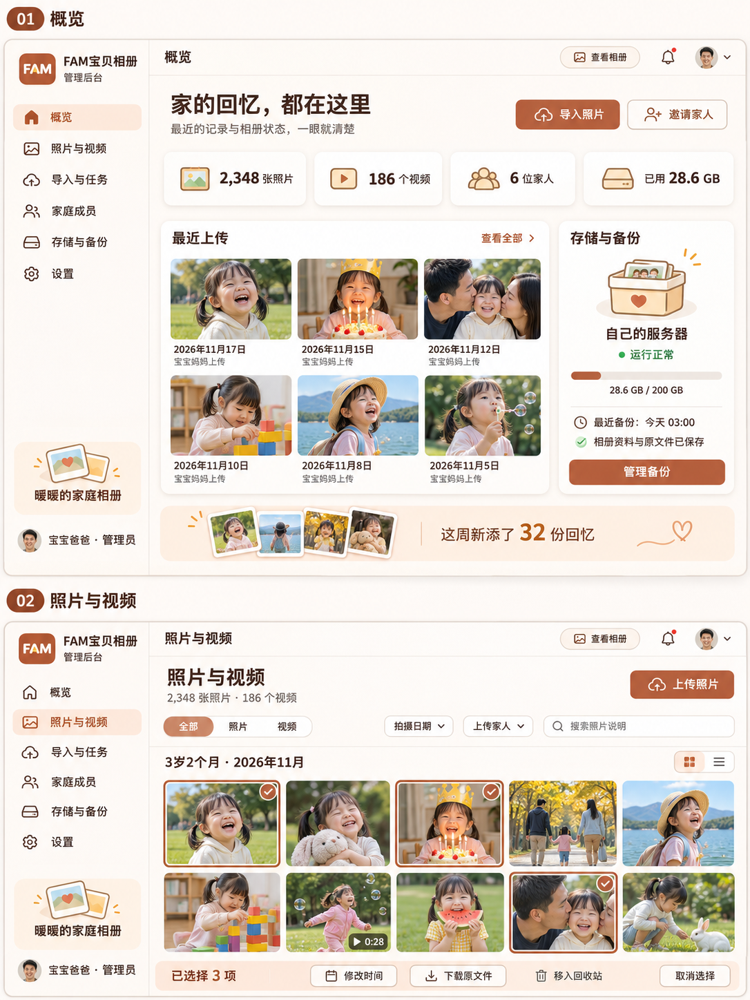

<p align="center"></p>

# FAM宝贝相册

**把孩子的成长，留在自己选择的地方。**

开源、自托管的宝宝相册、亲子相册与家庭相册。提供安卓 App 和管理员网页后台，支持多宝宝、家人协作、成长回忆，以及自己的服务器、NAS、阿里云 OSS、腾讯云 COS 和通用 S3 存储。

没有会员开关，不需要向项目作者注册账号。每个家庭部署自己的相册服务，自己管理照片、账号与存储。

[界面预览](docs/界面预览.md) · [下载安卓版](https://github.com/itxxkgz/fam-baby-album/releases/latest) · [部署说明](docs/部署与存储.md) · [网页后台](docs/网页管理后台.md) · [版本说明](docs/版本说明.md) · [反馈问题](https://github.com/itxxkgz/fam-baby-album/issues)

| 组件 | 当前版本 | 用途 |
| --- | --- | --- |
| 安卓 App | 2.12.0，Android 8 及以上 | 顶部下拉刷新、图库多选和后台上传 |
| 服务端与网页后台 | 2.9.2 | 保存资料、控制权限、管理和备份相册 |

## 界面预览

奶油白、杏桃色和陶土橙，让照片与成长故事成为页面的主角。下面是整理后的**设计示意图**，人物和相册资料为虚构示例；实际页面会随版本与家人权限有所不同。

**相册与成长时光**：按年龄回看照片，从“从小到大”和“每月故事册”进入各自的回忆。



**我的与家人动态**：家人、宝宝相册和常用操作放在一起，上传合并展示，回应直接对应照片。


<details>
<summary><strong>展开查看网页后台设计</strong></summary>

后台延续相同暖色风格，在电脑上整理照片、导入文件和管理相册。下图为概览与照片管理的设计稿。



</details>

**[查看完整设计图集 →](docs/界面预览.md)**：共 10 组，包含成长对比、每月故事册、宝宝与家人、照片存放、NAS 与云存储，以及后台六个入口。

## 可以做什么

- **多宝宝相册**：每位宝宝有自己的照片、生日、成长记录与家人权限；合照可以加入多个宝宝相册，原文件只保存一份。
- **按年龄回看**：以成长年龄组织照片，按年龄或日期定位，拖动时间轴时照片实时跟随。
- **沉浸浏览**：手机左右翻页、双指缩放；网页滚轮缩放、拖动和恢复整张，视频支持播放与进度拖动。
- **成长回忆**：从小到大回看代表照，对比两个年纪；每月故事册可以选封面、补文字和调整顺序。
- **家人一起记录**：填写称呼生成六位邀请码，用“管理”和“上传”开关分配权限；支持评论、回复、收藏和快捷回应。
- **保留原文件**：上传照片和视频，优先读取原拍摄时间，也可手动修正相册中的时间，支持下载原件。
- **灵活存储**：自己的服务器、已挂载 NAS、阿里 OSS、腾讯 COS 或兼容 S3 的对象存储。
- **网页管理**：批量整理、电脑和服务器目录导入、后台任务、定时备份、备份下载和独立副本恢复。

一套服务面向一个家庭，可包含多位宝宝。网页后台只供家庭管理员使用，家人日常浏览和记录使用安卓 App。

## 用 Docker 开始

服务器需要 Docker Engine 和 Docker Compose：

```sh
git clone https://github.com/itxxkgz/fam-baby-album.git
cd fam-baby-album
mkdir -p library
cp .env.example .env
docker compose up -d --build
```

默认仅监听部署机器的 `127.0.0.1:8765`，网页后台位于 `/admin/`。在自己电脑上部署，可打开 `http://127.0.0.1:8765/admin/`。

远程服务器可以先从电脑建立 SSH 转发，把下面的用户和服务器地址替换成自己的连接信息：

```sh
ssh -L 8765:127.0.0.1:8765 用户名@服务器地址
```

保持连接，在电脑打开 `http://127.0.0.1:8765/admin/` 完成首次设置。

**全新相册的初始账号和密码都是 `admin`，首次登录必须设置自己的新密码。** 已有相册升级不会恢复默认账号。向家人开放前，按[部署与存储](docs/部署与存储.md)配置 HTTPS，并同时代理 `/admin/` 和 `/api/`。

相册资料保存在 `album-data` 数据卷中，`library` 是只读原始图库。升级时保留数据卷和图库，在同一目录执行 `docker compose up -d --build`。不要为了更新程序删除数据卷，详见[备份与升级](docs/备份与升级.md)。

## 手机怎么连接

1. 从 [Releases](https://github.com/itxxkgz/fam-baby-album/releases/latest) 下载并安装 APK。
2. 填写自己的相册服务地址，例如 `https://album.example.com`，不要加 `/admin/`。
3. 管理员用自己的账号登录，家人使用管理员生成的邀请加入。

App 连接相册后端，由后端访问 NAS 或云存储。不同服务器是独立相册，在本机修改账号不会自动修改另一台服务器上的账号。全新部署不包含演示家庭、照片或预设家人。

## 照片存在哪里

| 方式 | 保存位置与准备 |
| --- | --- |
| 自己的服务器 | 运行后端的服务器硬盘，需要可读写目录 |
| NAS | 后端已挂载的 NAS 目录，需要挂载与目录权限 |
| 阿里 OSS | 自己的私有存储桶，需要地域、存储桶与访问密钥 |
| 腾讯 COS | 自己的私有存储桶，需要地域、完整存储桶名称与访问密钥 |
| 通用 S3 | 兼容服务或自建对象存储，需要服务地址、存储桶与访问密钥 |

云访问密钥只保存在服务端。更换新上传位置不会自动搬迁旧文件；原件、数据库和存储密钥都需要备份。[查看配置方法](docs/部署与存储.md)

## 在电脑上开发

服务端需要 Python 3.11 及以上和 FFmpeg。将 `ffmpeg`、`ffprobe` 加入命令行路径后，在 Windows 执行：

```powershell
python -m venv .venv
.venv\Scripts\python -m pip install -r server/requirements.txt
.venv\Scripts\python tools/start_local.py
```

Linux/macOS 将 Python 路径改成 `.venv/bin/python`。本机连接说明生成在 `.private`，网页随服务端运行，无需单独启动前端服务。

安卓构建需要 PowerShell 7、JDK 21、Android SDK 平台 36 和 Build Tools 36。设置 `JAVA_HOME`、`ANDROID_HOME` 后执行：

```powershell
pwsh -File build.ps1
# 如需同时安装到已连接的模拟器：
pwsh -File build.ps1 -Install
```

输出为 `dist/FAM宝贝相册.apk`。首次构建会为自己的发行版生成签名，保存在 `.private`；后续更新应沿用同一份签名。不同签名的自行构建版不能直接覆盖 Releases 的官方安装包。签名和密码不要提交到仓库。

服务端和网页检查需要 Node.js 22.13 或更新版本：

```sh
python -m pip install -r server/requirements-dev.txt
npm ci --prefix tools/admin-web-tests --ignore-scripts
python tools/check.py
```

测试使用独立临时资料，不需要连接正在使用的相册。详见[开发与验证](docs/开发与验证.md)。

## 使用说明

- [完整设计图集](docs/界面预览.md)：主要页面、二级页面与网页后台的暖色设计。
- [多宝宝相册](docs/多宝宝相册.md)：宝宝切换、合照共享与家人权限。
- [浏览照片与视频](docs/浏览照片与视频.md)：筛选、时间定位、翻页和缩放。
- [成长与故事册](docs/成长与故事册.md)：成长对比、月份封面与故事编辑。
- [家人与动态](docs/家人与动态.md)：邀请、权限开关、动态合并和回应。
- [网页管理后台](docs/网页管理后台.md)：六个管理入口、导入任务和备份。
- [部署与存储](docs/部署与存储.md)：Docker、HTTPS、NAS 和对象存储。
- [备份与升级](docs/备份与升级.md)：备份范围、恢复副本和升级。
- [界面约定](docs/暖色界面.md)：暖色风格、图标与交互规则。

## 当前范围

当前不提供 iOS App、普通家人的网页相册、多家庭租用平台或端到端加密。手机上传和电脑传输暂不支持断点续传；服务器导入任务在文件传完后可以继续处理。后台备份保存在服务器本地，异地备份需另行安排。

OSS、COS 和 S3 适配已提供，真实云服务连接需要用自己的独立测试环境验证；本地测试通过不代表所有云厂商配置都已实测。

## 参与与许可

欢迎通过 [Issues](https://github.com/itxxkgz/fam-baby-album/issues) 反馈问题或通过 Pull Request 提交改进。请阅读[参与开发](CONTRIBUTING.md)和[安全说明](SECURITY.md)，公开反馈使用虚构账号与测试素材。

代码采用 [Apache License 2.0](LICENSE)，依赖遵守各自许可，见[第三方说明](THIRD_PARTY_NOTICES.md)。用户自己的照片、视频与资料不属于代码许可范围。
