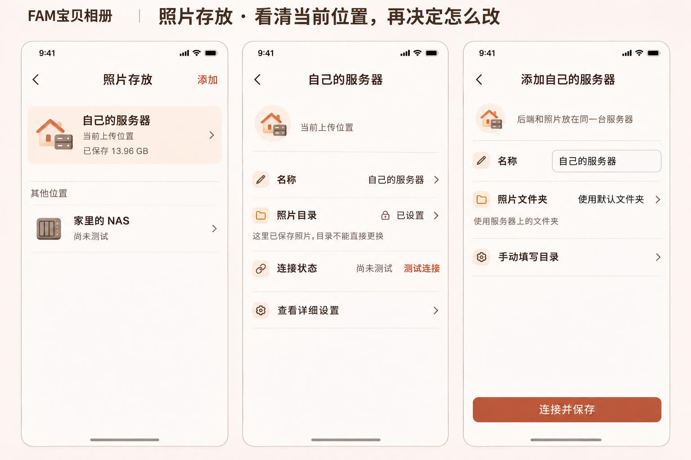
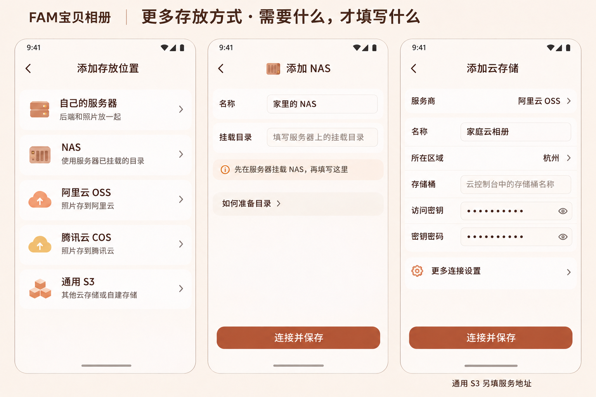

# FAM宝贝相册 · 设计图集

把相册、成长故事和家人的记录放在同一套暖色界面里。这里整理了 10 组主要设计，可以点击图片查看大图。

**这些是设计示意图，不是运行截图。** 人物、照片、姓名和数值均为虚构示例。部分设计早于当前版本，页面名称、权限操作和布局细节可能已有调整；使用方式以[项目首页](../README.md)和对应功能说明为准。

[相册与时光](#相册与成长时光) · [我的与动态](#我的与家人动态) · [成长对比](#从小到大) · [每月故事册](#每月故事册) · [宝宝与家人](#宝宝与家人) · [照片存放](#照片存放) · [NAS 与云存储](#nas-与云存储) · [网页后台](#网页后台)

## 相册与成长时光

照片组以宝宝当时的年龄为主标题，日期作为辅助。成长时光将成长回看、每月故事册、视频与收藏放在独立入口里。

[浏览照片与视频的使用方法](浏览照片与视频.md)

## 我的与家人动态

“我的”集中家人、宝宝相册、收藏、回收站和照片存放。动态把连续上传合在一起，照片、视频与留言可以分别查看。

[家人与动态的使用方法](家人与动态.md)

## 从小到大

按年龄挑选代表照，把两个年纪放在一起比较，也能连续播放成长照片。

## 每月故事册

用照片作封面，像翻书一样回看一个月。可以整理书页、添加故事、选择封面和调整顺序。

[成长与故事册的使用方法](成长与故事册.md)

## 宝宝与家人

每位宝宝都有独立相册，可以在列表中切换。添加家人只填写称呼，加入后再用“管理”和“上传”两个开关调整权限。

[多宝宝相册与权限说明](多宝宝相册.md)

## 照片存放

先看清当前上传位置，再查看详情或添加新的位置。常用信息直接展示，手动目录等配置按需展开。

## NAS 与云存储

支持自己的服务器、已挂载 NAS、阿里 OSS、腾讯 COS 和通用 S3。不同方式只填写各自需要的资料。

[部署与存储说明](部署与存储.md)

## 网页后台

后台六个入口分别承担概览、照片整理、导入任务、宝宝与家人、存储备份和设置。下面保留早期完整设计，展示桌面端的暖色风格；当前版本已进一步简化表单和权限操作。

### 概览与照片管理

集中查看相册状态，在较大的照片网格中筛选、选择和批量整理。

### 导入任务与家人

查看导入进度、失败项目和家人列表。当前版本的添加家人只填写称呼，权限在家人信息里使用“管理”“上传”开关设置，已简化图中的早期表单。

### 存储、备份与设置

存放位置、备份计划和备份记录分开管理。图中的容量和状态是设计示例；当前备份写入服务器本地，可下载另存，选择 NAS 或云存储作为照片位置不会自动开启异地备份。宝宝资料在当前版本的“宝宝与家人”中编辑。

[网页管理后台说明](网页管理后台.md) · [备份与恢复说明](备份与升级.md)

## 图片来源与后续维护

以上图片均来自本项目使用内置 imagegen 制作的设计稿。相册与成长时光、我的与动态、宝宝与家人三组已整理为公开展示版，替换私人参考人物与资料，统一使用 FAM宝贝相册名称；其余为核对后的原设计示意图。

公开图片集中保存在 `docs/design/public`。补充设计时使用虚构人物与测试资料，不上传家庭参考照片、真实姓名、生日、邀请码、密码或存储密钥。新增图片同时更新图集与源码打包清单。

[返回项目首页](../README.md)
